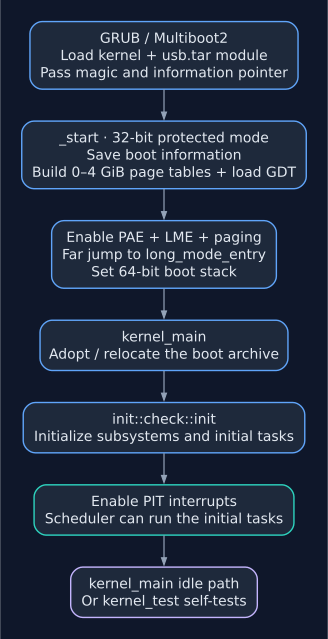

# Build and Run

## Prerequisites

Run `make init` once to install the toolchain:

```sh
make init
```

This installs the Rust tools listed below. The other host utilities must be
installed separately:

- Rust nightly via `rustup`
- Target `x86_64-unknown-none`
- Components `rust-src` and `llvm-tools-preview`
- `bootimage` cargo subcommand
- `grub2-mkrescue` (or `grub-mkrescue`), `xorriso`, GNU Make and `tar` for ISO/archive creation
- GRUB platform modules: `i386-pc` for legacy BIOS boot, `x86_64-efi` for Intel Mac/UEFI boot
- QEMU (`qemu-system-x86_64`) for the run targets
- `mtools` (`mmd`, `mcopy`) and `mkfs.fat` for floppy image creation

---

## Build

### Release build (both video modes)

```sh
make build
```

Produces `r2.iso`. Internally runs two cargo invocations (with `-Z build-std=core,compiler_builtins -Z json-target-spec --target x86_64-r2.json`):

| Feature flag | Output ELF | Description |
|---|---|---|
| `kernel_text` | `iso/boot/kernel_text.elf` | VGA text-mode path |
| `kernel_graphics` | `iso/boot/kernel_graphics.elf` | VESA framebuffer path |

The feature selects the Multiboot2 header and graphics-session startup policy.
The graphics header requests a 32-bit framebuffer without a fixed resolution;
GRUB chooses the mode. Both builds share the same kernel subsystems.

Both ELFs are placed inside `iso/boot/`. `build_iso` then copies the userland binaries from the [apps repository](sdk/index.md) (expected at `../r2_app`) into `iso/bin/`, and `grub2-mkrescue` assembles the `iso/` tree into `r2.iso` with the modules `multiboot2 video video_bochs video_cirrus gfxterm all_video`.

The resulting ISO is mounted at `/mnt/iso` at boot:

| ISO path | Contents |
|----------|----------|
| `/boot` | `kernel_text.elf`, `kernel_graphics.elf`, GRUB config |
| `/bin` | Userland programs (`eth`, `wgd`, `garn`, `tnt`, `chat`, `sh`, `fsck`, `nsk`, `them`, `hellofs`, `hello`, `dish`, `gfxdemo`, `routtest`, `snake`, `mines`, …). Searched by `bg`/`fg` when a binary is not in the working directory. |
| `/games` | Optional DOS games for the `THEM` emulator (not part of the repository) |
| `/opt` | Startup script, application configurations, CA bundle, bsh examples and C8 ROMs |
| `/include`, `/lib` | TCC headers, startup objects and libraries |
| `/sound`, `/pics`, `/video` | Staged MIDI files, images and films |

The current `build_iso` target rebuilds Memento through `build_desktop`, plus
selected C applications (`cube`, `c8`, `r2sh`, `tnt`, `wgd`, `chat`). It copies
other prebuilt binaries from `../r2_app` and stages TCC's sysroot, configurations,
media and application data. Build those dependencies first; missing inputs
stop the target. Some inputs are machine-specific, including `../../tcpp/r2`
and game directories under the developer's `Downloads` directory.

Everything outside `iso/boot/` is also packed as `iso/boot/usb.tar`, which GRUB
loads as a module. The kernel mounts that archive at `/mnt/tar`; it is the
source of programs and data when booted from USB without a storage driver.
See [Boot Medium Archive](filesystem/overview.md#boot-medium-archive-mnttar).

### Legacy BIOS USB boot

Use `r2.iso` for a PC booting in legacy BIOS mode. `make image_iso` requires
GRUB's `i386-pc` modules and explicitly selects that platform. It produces a
BIOS-only CD/USB hybrid image with BIOS boot code and one active MBR partition,
without GPT or Apple partition tables. Installing `x86_64-efi` modules does
not change this layout. Use `r2-efi.iso` for EFI machines and Intel Macs.

Leaving GRUB's platform selection automatic previously allowed installing EFI
modules to change `r2.iso` to a GPT/APM image with a protective MBR. Forcing
an active marker alone left that layout in place. A BIOS that rejects it can
still omit the stick from its boot menu or report it as unbootable, even when
QEMU boots it successfully. Selecting `--directory=/usr/lib/grub/i386-pc`
restores the simpler legacy layout; `--mbr-force-bootable` retains the active
marker. To use modules installed elsewhere, set
`GRUB_BIOS_DIR=/path/to/i386-pc`.

To rebuild an already staged image after this fix:

```sh
make image_iso
xorriso -indev r2.iso -report_el_torito plain -report_system_area plain
```

Expect a `BIOS` boot image, `grub2-mbr` in the system area, and an MBR
partition with status `0x80` and type `0xcd`. There should be no GPT, APM,
UEFI boot image, or dummy active entry of type `0x00` in this BIOS image.
Write the rebuilt `r2.iso` as an image to the **whole USB disk**, replacing
its contents, rather than to one partition or as a copied file. Select the
legacy USB boot entry in the PC's firmware. `r2-efi.iso` is EFI-only and
cannot boot a BIOS machine.

### Intel Mac USB boot (including MacBook Pro 2012)

`make image_iso` deliberately produces a BIOS-only `r2.iso`. For the Intel
Mac's native USB boot path, `make image_efi` selects the `x86_64-efi` modules
and produces `r2-efi.iso` separately. Installing `grub2-tools` alone may not
provide those EFI modules; the EFI target checks them before creating an image.

Install the EFI modules on the Linux build host:

```sh
# Fedora
sudo dnf install grub2-efi-x64-modules

# Debian/Ubuntu
sudo apt install grub-efi-amd64-bin
```

After `make build` has staged the kernels and applications, create the explicit
EFI image. This target also works with an existing populated `iso/` tree:

```sh
make image_efi
```

This produces `r2-efi.iso`, containing an EFI System Partition and the removable
media loader `/EFI/BOOT/BOOTX64.EFI`. It rebuilds `usb.tar` from the staged files
without recompiling the kernels or applications. The target fails with package
instructions if EFI modules are missing. For modules extracted elsewhere, use
`make image_efi GRUB_EFI_DIR=/path/to/x86_64-efi`; `GRUB_MKRESCUE` can override
the selected host command.

The EFI target also converts `docs/assets/favicon.ico` into
`docs/assets/r2-boot.icns` and installs it as `.VolumeIcon.icns` in both the FAT
EFI partition and the ISO/HFS+ volume root. The green r2 lettering keeps its
transparency and pixel edges. Classic RGB resources and alpha masks are included
for older Intel Mac firmware, alongside PNG resources for newer pickers. See
[Mac boot picker icon compatibility](https://dortania.github.io/OpenCore-Legacy-Patcher/ICNS.html#custom-mac-boot-picker-icons).
Icon generation needs Python 3 and Pillow (`python3-pillow` on Fedora and
Debian/Ubuntu); the EFI image step also uses GRUB's existing `mtools` dependency.
`make image_efi` regenerates the icon when the favicon changes. The BIOS image
target remains independent of this icon step.

Flash **`r2-efi.iso` as a disk image** to the USB stick, replacing its contents;
copying the ISO file onto a filesystem is insufficient. On the Mac, power on
while holding **Option (⌥)** and select the green **r2** icon (the entry may still
be called **EFI Boot** on some firmware), then choose the ordinary
**graphics** GRUB entry. See [Apple's startup key
instructions](https://support.apple.com/en-gb/102603).

Check an image before flashing:

```sh
xorriso -indev r2-efi.iso -report_el_torito plain -report_system_area plain
```

Expect a `UEFI` boot image and a GPT `EFI boot partition`. A report containing
only `BIOS` confirms that the image has no EFI bootloader. If the Mac shows
**EFI Boot** but reports “no bootable device” before the GRUB menu appears,
verify which image was flashed and how it was written: the boot picker entry
alone does not establish that R2's loader was reached. A failure after the GRUB
menu is a different stage; record its exact message.

EFI boots initialize native USB input automatically. The PCI xHCI driver handles
switchable external USB ports; the EHCI driver handles USB2 ports and internal
hubs, including the MacBook's keyboard/trackpad path. On BIOS, select the
**USB input (xHCI + EHCI)** entry or add `usb=xhci` to the kernel command line.
This option enables both drivers; `usb=firmware` keeps firmware input instead.

HID boot mice and keyboards connected before boot are supported. The Apple
Wellspring trackpad driver recognizes the 2011/2012 MacBook Pro USB IDs, including
June 2012 Retina models. It enables native touch reports and provides relative
pointer movement, physical click/drag, and a right click when two fingers are
present at click-down. Keyboard and trackpad interfaces are initialized together.
Tap-to-click, scrolling/gestures, and runtime device attachment are not implemented.
See [USB mouse and MacBook trackpad support](input/mouse.md#usb-mice-and-macbook-trackpads)
and [USB keyboard support](input/keyboard.md#usb-keyboards-xhci).

After changing drivers, rebuild the kernels and the EFI image:

```sh
make compile_kernel
make image_efi
```

The ordinary graphics entry then starts Memento with native USB input. These
paths have host and QEMU tests; the built-in trackpad still needs verification
on a physical Mid-2012 MacBook Pro. Avoid the **PS/2 input only** entries
(`usb=os`) on a Mac: they stop USB controllers without starting native input.

On EFI, the **text mode** entries use the framebuffer-capable kernel with
`console=fb`. R2 draws an 80x25 text console on the RGB framebuffer and starts
the kernel shell instead of Memento. This avoids GRUB's “no console will be
available” warning for a VGA-only kernel and makes commands such as `nic`
visible. BIOS text entries continue to use the VGA text kernel.

If ETH exits immediately, boot **text mode, USB input (xHCI + EHCI)** and run
`nic`. It now lists PCI network controllers even when no Ethernet driver is
registered, including vendor/device IDs and available R2 backends. In Memento,
open `/mnt/tmp/NETINFO.TXT` in the file browser or run
`cat /mnt/tmp/NETINFO.TXT` in a shell window. The file is generated at boot
and refreshed when ETH registration succeeds or fails.

R2 supports RTL8139, selected Intel e1000/e1000e/PCH Ethernet controllers,
and the wired Broadcom BCM57765 (`14e4:16b4`). The BCM57765 backend sets up
copper autonegotiation and polled packet rings; it does not drive the Mac's
wireless controller. Its initialization stage, PHY, link speed and ring state
appear in `nic` and `NETINFO.TXT`. BCM57765 hardware traffic still needs
validation on a physical Mac; QEMU checks only the existing boot/NIC paths.
An unsupported controller requires its own driver; an Ethernet cable or DHCP
settings cannot fix that. Serving GARN at `http://localhost` uses the kernel's
loopback path and does not establish support for the physical Ethernet port.

### Graphics session

The graphics kernel maps the framebuffer write-combining at boot. When GRUB
provides an RGB framebuffer, it starts neither `kshell` nor `kclock`; Memento
owns the ordinary graphics session. An EFI text entry uses `console=fb` to
start a visible kernel shell on that framebuffer instead.

In an ordinary graphics session, `init_rc` runs the startup script and then
starts Memento in the foreground.
Use the floppy's `INIT.RC` when present; an empty or missing script on the
graphics build falls back to `/mnt/tar/opt/init.rc`, then `/mnt/iso/opt/init.rc`.
The build copies `configs/init.rc` to both boot-medium copies. Keep `fg memento`
out of the graphics startup script, since the session launcher starts it itself.

Memento scales its desktop by the largest whole number that leaves at least
640×400 pixels (1920×1080 gives 960×540 at 2×), uses 256 colours, and sends
changed rows through [indexed blitting](abi/syscalls/video_audio.md#0x19-blit-an-8-bit-indexed-frame).
To request a particular GRUB mode, add `set gfxpayload=1920x1080x32` after
`multiboot2` and before `boot` in the graphics menu entry. The
[GRUB Multiboot loader](https://raw.githubusercontent.com/rhboot/grub2/master/grub-core/loader/multiboot.c)
resets `gfxpayload` from the kernel header when it loads the kernel.

The launcher stays alive as the desktop supervisor. After a cooperative
[Jug relaunch](sdk/jug.md), it preserves Memento's arguments, adds `--relaunch`
and starts the updated copy without rerunning the script or rebooting. An
ordinary exit, kill or crash restarts the machine if that desktop ran for at
least five seconds; a failed or shorter launch ends the supervisor without
restarting. See [desktop relaunch ABI](abi/syscalls/sysinfo_mem_mgmt.md#0x42-coordinated-desktop-relaunch).
On the text kernel, use `fg memento` to run the 640×400 VGA desktop and return
to the rescue shell when it exits.

### WireGuard applications

The image build rebuilds the C `wgd`, `sh` and `tnt` applications and relinks `chat`. It packages `wgd.elf` and `/opt/wgd/wgd.cfg.example` into the ISO and boot archive; the example has key placeholders and needs a separate completed configuration. Starting the daemon is a shell or `INIT.RC` choice.

Rebuild and boot the kernel too: `wgd` and the shell's subnet `ping`/`traceroute` commands require [syscall `0x44` ABI 2](abi/syscalls/port_networking.md#0x44-userspace-ipv4-tunnel). Relink other libcr2 TCP servers to preserve the tunnel destination as their reply source. See [WireGuard](networking/wireguard.md) for configuration, physical network prerequisites, diagnostics and entropy fallback.

### Debug build

Build both release kernels once before making a debug image: the debug target
replaces only `kernel_text.elf`, while GRUB still includes the graphics entry.

```sh
make build_debug
```

Runs `compile_kernel_debug` and `build_iso`. Builds the text-mode kernel with features `kernel_text,serial_debug`. Serial debug output is written to COM1 (`rprint!`/`rprintb!`/`rprintn!` macros). Note: serial debug disables SLIP networking (both use COM1).

Optional extra features:

```sh
make build_debug EXTRA_FEATURES=serial_debug
```

### Clean

```sh
make clean    # cargo clean
```

---

## Target Specification (`x86_64-r2.json`)

| Field | Value |
|---|---|
| `llvm-target` | `x86_64-unknown-none` |
| `os` | `none` |
| `linker` | `rust-lld` (LLD) |
| `relocation-model` | `static` |
| `panic-strategy` | `abort` |
| `disable-redzone` | `true` |
| `features` | `-mmx,-sse,+soft-float` |
| `exe-suffix` | `.elf` |

SSE is disabled at the target level; SSE is re-enabled at runtime by `init::cpu::enable_sse` (after the kernel stack is set up). The `soft-float` feature prevents LLVM from emitting SSE instructions before that point.

---

## Linker Script (`linker.ld`)

The kernel is linked starting at physical address `0x100000` (1 MiB).

| Region | Address / size | Notes |
|---|---|---|
| `.multiboot2_header` | `0x100000` (4 KiB aligned) | GRUB Multiboot2 header |
| `.text` | follows | All code |
| `.rodata` | follows | Read-only data, embedded fonts |
| `.data` + `.dma` | follows | Writable globals; `.dma` section holds the `DMA: [u8; 512]` floppy buffer at a known physical address |
| `.bss` | follows | Zero-initialised statics |
| `.gdt` | follows | GDT descriptor (assembly) |
| `.idt` | follows | IDT descriptor (assembly) |
| `.boot_reserved` (`NOLOAD`) | follows, 16-byte aligned | Covers stack, heap and page tables so GRUB does not place a module over them |
| `__stack_bottom/top` | 64 KiB in `.boot_reserved` | Kernel boot stack |
| `__heap_start/end` | 64 KiB in `.boot_reserved` | Kernel linked-list heap |
| `p4_table` | 4 KiB aligned, in `.boot_reserved` | PML4 page table |
| `p3_fb_table` | 4 KiB in `.boot_reserved` | P3 table for framebuffer mapping |
| `.user_task` | `0x650000` | Unused user-task section placeholder |
| `.dma` (DMA buffer) | `0x80000` (512-byte aligned) | Physical DMA target for ISA DMA channel 2 |

The `p2_table`, `p2_high_tables`, `p3_table`, `ist0/ist1_stack` (16 KiB each: the double fault runs on `ist0_stack` via TSS `ist1`, the page fault on `ist1_stack` via `ist2`), `tss64`, `multiboot_ptr`, and `debug_flag` symbols all live in assembly `.bss` in `boot.asm`.

---

## Boot Flow

[](assets/diagrams/boot-flow.svg)

*Boot handoff from GRUB to Rust and the scheduler. The assembly operations below
expand the middle stages; [subsystem initialization](init/overview.md#boot-sequence)
expands the final setup.*

```
GRUB (Multiboot2)
  │  loads r2.iso, selects kernel ELF
  │  passes Multiboot2 info pointer in EBX, magic in EAX
  ▼
_start  (boot.asm, 32-bit protected mode)
  ├── saves EBX/EAX → [multiboot_ptr] / [multiboot_magic]
  ├── loads P4 table address into CR3
  ├── set_up_page_tables()
  │     identity-maps 1 GiB via P2 (512 × 2 MiB huge pages)
  │     identity-maps 1–4 GiB via 3 more P2 tables (p2_high_tables, 2 MiB pages;
  │     not 1 GiB pages, which need the optional pdpe1gb CPU feature)
  │     marks P2[2..4] USER+WRITE (0x400000–0xA00000, userland range)
  ├── load_gdt()    — lgdt from gdt_descriptor
  ├── load_idt()    — lidt (empty; real IDT installed by init later)
  ├── set segment registers to data selector 0x10
  ├── enable_paging()
  │     CR4 bit 5 (PAE), EFER bit 8 (LME), CR0 bit 31 (PG)
  └── far jump to long_mode_entry (selector 0x08 = 64-bit code)
  ▼
long_mode_entry  (boot.asm, 64-bit long mode)
  ├── TLB flush (mov cr3, cr3)
  ├── set segment registers to 0x10
  ├── RSP ← __stack_top  (64 KiB kernel stack)
  └── call kernel_main(multiboot_magic, multiboot_ptr)
  ▼
kernel_main  (src/main.rs)
  ├── fs::ustar::module::adopt(multiboot_ptr) — relocate boot archive if needed
  ├── init::check::init(multiboot_ptr)        — subsystem initialization
  │     (see Boot and Initialization)
  └── task::scheduler::idle(0xff)        — enters scheduler; never returns
```

### GDT Layout (from `boot.asm`)

| Selector | Descriptor | Description |
|---|---|---|
| `0x00` | null | Required null descriptor |
| `0x08` | `0x00AF9A000000FFFF` | Kernel code (64-bit, DPL=0) |
| `0x10` | `0x00AF92000000FFFF` | Kernel data (DPL=0) |
| `0x18` | `0x00affa000000ffff` | User code (64-bit, DPL=3) |
| `0x20` | `0x00aff2000000ffff` | User data (DPL=3) |
| `0x28` | TSS descriptor (patched at runtime) | 64-bit TSS |

The TSS descriptor at `0x28` is initially a placeholder; `init::idt::setup_tss_descriptor` overwrites it with the correct base address and limit before `ltr 0x28` is issued.

---

## Floppy Image (`make build_floppy`)

Creates a 1.44 MB FAT12 floppy image (`fat.img` by default, override with `FLOPPY_IMAGE=`):

```sh
make build_floppy
make build_floppy FLOPPY_IMAGE=my.img
```

1. `dd` creates a blank 2880-sector image.
2. `mkfs.fat -F 12` formats it.
3. `mmd` creates directories: `BIN`, `GARN`, `GFX`, `SLIP`, `SOUND`, `THEM`, `DYNA`.
4. `mcopy` copies data files and demos (from `../r2_app/` and this repository):

| Floppy path | Source |
|-------------|--------|
| `INIT.RC` | `configs/init.rc` |
| `GARN/GARN.CFG`, `GARN/INDEX.HTM`, `GARN/HELLO.TXT`, `GARN/FAVICON.ICO`, `GARN/SOCKETS.JSN` | GARN web server config and content |
| `GFX/CUBE.ELF`, `GFX/GFXTEST.ELF` | Graphics demos; Memento is in the boot medium's `bin/` |
| `SLIP/ICMPR.ELF` | ICMP responder over SLIP |
| `SOUND/*.MID` | MIDI files for syscall `0x1b` |
| `THEM/PRG0.BIN`, `THEM/VLAK.COM` | Real-mode programs for the `THEM` emulator |

The main programs are no longer copied to the floppy: they live in `/mnt/iso/bin` on the ISO, which leaves the 1.44 MB floppy for data.

The `INIT.RC` file is the startup script parsed by `init_rc` at boot (see below).

---

## Startup Script (`configs/init.rc`)

`init_rc` reads up to 1024 bytes of `INIT.RC` from the floppy root. On the
graphics build, an empty or missing script falls back to the boot medium's
`opt/init.rc` as described in [Graphics Session](#graphics-session). Each
non-blank, non-comment line goes through `cmd::handle`, the same dispatcher
used by the rescue shell. Only the file's actual length is interpreted.

Example startup script (the checked-in `configs/init.rc` also contains local
working-directory choices):

```sh
# Start network driver
bg eth

# Start TNT with config
bg tnt eth

# Start GARN web server
bg garn --config /mnt/tar/opt/garn/garn.cfg

echo INIT.RC done
```

Binary names are resolved like in the shell: `/mnt/tmp/jug` first for downloaded updates, then the working directory, then `/mnt/tar/bin` and `/mnt/iso/bin`, so `bg eth` works without the program being on the floppy. `init_rc` starts at `/`, which holds no files, so until a `cd` it takes shipped programs from the bin directories. A `fg` line parks `init_rc` until that program exits.

Lines starting with `#` are ignored. Trailing `\r` is stripped (DOS line endings tolerated).

---

## Taking USB from the Firmware

With `usb=os` on the kernel's command line, the kernel takes the USB host controllers from the firmware at boot, before it sets up the PS/2 mouse (`src/usb/`, the boot line *Taking the USB controllers from the firmware*). `grub.cfg` has a text and a graphics entry with it, marked *PS/2 input only*. In the GRUB menu you can also press `e` and add `usb=os` to the `multiboot2` line.

Use it on real hardware when pulling out the USB stick freezes the machine. The firmware's SMM code still drives the controllers to emulate a PS/2 keyboard and mouse. A stick pulled out is an SMI the firmware may spend seconds on, and the kernel cannot mask it. This ownership-only mode stops the controllers, leaving input to real PS/2 devices. The boot line reads `FAIL` if a controller's registers were out of reach, or if the firmware did not let go and had to be overruled. In that case, look for *XHCI/EHCI Hand-off* in the firmware setup and turn it on. The kernel shell's [`usb`](shell.md#usb) command shows the state of each controller, and `usb take` does the same handoff later, also stopping both native USB input drivers.

For native USB keyboard/mouse/trackpad input, use `usb=xhci` instead. EFI boots enable it
automatically unless `usb=os` or `usb=firmware` is present. BIOS boots retain
firmware input by default. See [USB input support](input/mouse.md#usb-mice-and-macbook-trackpads)
for device support and current limits.

---

## Run Targets

| Make target | Description |
|---|---|
| `make run_iso` | QEMU with CD-ROM only, 2 GB RAM, VGA std, serial PTY |
| `make run_iso_floppy` | Recreates `fat.img`, then boots with the floppy and PC speaker audio; existing image data is overwritten |
| `make run_iso_net` | CD + floppy + RTL8139 NIC on `tap0` + PC speaker audio, GTK display, serial PTY |
| `make run_iso_debug` | CD + floppy, 4 GB RAM, serial → stdio, audio, no-reboot/no-shutdown |
| `make run_iso_debug_int` | Same + `-d int,cpu_reset,page` (interrupt tracing) |
| `make run_iso_pty PTY_NUMBER=ptyN` | CD only, serial on specific PTY |
| `make run_iso_usb` | CD replaced by `/dev/sdb` (USB stick) |
| `make run_iso_floppy_drive` | Live floppy `/dev/sda` (requires sudo) |

Standard run with networking:

```sh
make run_iso_net
```

QEMU network setup assumes `tap0` is already created on the host. The kernel probes RTL8139 first, then supported Intel controllers, then BCM57765 via PCI scan. To test Intel in QEMU, replace the target's `-device rtl8139,netdev=net0` with `-device e1000,netdev=net0` or `-device e1000e,netdev=net0`; see [Hardware Layer](networking/hardware.md#nic-selection-and-intel-driver-nicrs-e1000rs).

```sh
sudo ip tuntap add dev tap0 mode tap
sudo ip link set tap0 up
sudo ip addr add 10.3.4.1/24 dev tap0
```

Before starting QEMU, `run_iso_net` also runs a few best-effort host tweaks with `sudo` (each one ignored if it fails): it sets the `tap0` MAC address, puts `tap0` and `10.3.4.0/24` into the firewalld `trusted` zone, disables reverse-path filtering on `tap0`, flushes conntrack, and adds an nftables raw-table accept rule for traffic from `tap0`. The guest uses `10.3.4.2` by default, with the host at `10.3.4.1`.

---

## Tests

### Kernel self-test (QEMU)

```sh
make test_kernel
```

Builds with features `kernel_test,kernel_text` into `target/ktest`, then boots
the existing `r2.iso` in headless QEMU with the `isa-debug-exit` device (`iobase=0xf4`) and serial on stdio. With `kernel_test` enabled, `kernel_main` runs `ktest::run_tests()` right after `init::check::init` instead of entering the idle loop. Each check uses `kassert!`, which exits QEMU on the first failure. QEMU exit code `33` (`0x10 << 1 | 1`) means all tests passed and prints `TESTS PASSED`; anything else prints `TESTS FAILED`.

The target currently does not copy the test ELF into the ISO, and the checked-in
GRUB default selects the graphics kernel. For a self-test run, build a separate
ISO with a single text-kernel entry. Start after a normal `make build` has
created `iso/boot/usb.tar`:

```sh
cargo build --features kernel_test,kernel_text --target-dir target/ktest \
  -Z build-std=core,compiler_builtins -Z json-target-spec --target x86_64-r2.json
mkdir -p /tmp/r2-selftest/boot/grub
cp target/ktest/x86_64-r2/debug/kernel.elf /tmp/r2-selftest/boot/kernel_text.elf
cp iso/boot/usb.tar /tmp/r2-selftest/boot/usb.tar
cat > /tmp/r2-selftest/boot/grub/grub.cfg <<'EOF'
set timeout=0
set default=0
menuentry "r2 kernel self-test" {
    multiboot2 /boot/kernel_text.elf
    module2 /boot/usb.tar usb
    boot
}
EOF
grub2-mkrescue -o /tmp/r2-selftest.iso /tmp/r2-selftest
qemu-system-x86_64 -boot d -m 256M -cdrom /tmp/r2-selftest.iso -fda fat.img \
  -device isa-debug-exit,iobase=0xf4,iosize=0x04 -serial stdio -display none -no-reboot
```

Check QEMU's exit status (`33` for success). These temporary files leave the
regular release ISO and GRUB menu intact.

The timer is already running when the tests start, so the processes the floppy's `INIT.RC` starts (`eth`, `tnt`, `garn`) run alongside them, and a run can fail now and then because of it. A floppy whose `INIT.RC` is a single NUL byte gives a quiet run. The tests also expect a floppy: `test_vfs_resolve` needs `/mnt/fat`, which is mounted only when one is found.

Tests in `src/ktest.rs`:

| Test | Checks |
|------|--------|
| `test_fat83` | 8.3 name conversion |
| `test_heap_alloc` | userland heap `malloc`/`free` |
| `test_heap_grow` | filling the 4 MiB heap grows it into its extension, which is user accessible, writable and given back by `free` |
| `test_vfs_resolve` | `/mnt/fat` and `/mnt/iso` prefix resolution |
| `test_path_normalize` | joining, `..` and relative paths in `vfs::normalize_path` |
| `test_mount_dir` | `/` lists `mnt`, `/mnt` lists the mount points with their types, and a mount or a path leading nowhere is no mount directory |
| `test_kerndbg_log` | init left its debug log in `/mnt/tmp/KERNDBG.LOG` |
| `test_memdisk_place` | the RAM disk is a sixteenth of the RAM in 2 MiB pages, in usable memory below 4 GiB, clear of the fixed regions and the archive |
| `test_memdisk` | the RAM disk at `/mnt/tmp` is FAT16 (with clusters of several sectors from 64 MiB): a file over three clusters read whole and from inside its second, a subdirectory grown past its first cluster, `write_file_at` appending and leaving a gap that reads back as zeros, delete |
| `test_small_disks` | disks carved out of the RAM disk's memory: FAT12 at 2 MiB, FAT16 at 4 MiB; a file across the FAT12 entry that straddles two FAT sectors, and a full disk that keeps earlier files intact |
| `test_slot_layout` | all 32 user stacks avoid the image window, frame addresses match slots, and the kernel ends below user memory |
| `scheduler::test_desktop_relaunch` | capability registration, request/poll, one-shot commit, parent identity and unsupported-launch handling |

### Host unit tests

```sh
make test
```

Compiles and runs `tests/unit/main.rs` and `tests/network/main.rs` as host Rust
test binaries (no QEMU). Pure modules are included directly by `#[path]`; the
network suite runs the production NIC/accounting and registry code with
hardware and scheduler stand-ins:

| File | Covers |
|------|--------|
| `tests/unit/fat12.rs` | 8.3 name conversion (a copy of `fat83`) |
| `tests/unit/midi.rs` | Standard MIDI File parsing and the monophonic sequencer (`src/audio/smf.rs`) |
| `tests/unit/path.rs` | Path normalisation (`src/fs/vfs/path.rs`) |
| `tests/unit/elf_path.rs` | Bare names, absolute executable paths, invalid input and length limits |
| `tests/unit/usb_hid.rs` | Composite USB descriptors, boot mouse packets, Wellspring touch reports, clicks, keyboard codes and repeat |
| `tests/unit/desktop.rs` | Preserving desktop arguments, adding `--relaunch` once, invalid and oversized commands |
| `tests/unit/bcm57765.rs` | BCM57765 descriptor ownership/wraparound, PCI power state, MAC validation, bounded reset/PHY waits and copper link resolution with a register model |
| `tests/unit/calendar_clock.rs` | Gregorian dates and CMOS decoding, clock adjustments, midnight rollover and independent uptime |
| `tests/network/main.rs` | NIC byte accounting, held frames, failed TX, independent TCP/UDP routing and ownership, ARP fanout, cleanup and layout sizes |

### Memento time synchronization

```sh
make -C ../r2_app/cpp/memento-hello settingstest ntptest nettest
python3 tests/time/qemu_ntp.py --grub-efi-dir /usr/lib/grub/x86_64-efi
```

The host suites test settings validation/layout, SNTP reply validation,
timeouts, retry limits and clock application. The VM test requires freshly
staged kernels and Memento in `iso/boot/usb.tar`, QEMU and OVMF. It uses a
local Ethernet peer for DHCP, ARP, UDP DNS and NTP, sends a stale reply before a valid
2040 timestamp, and checks the kernel wall clock and PIT tick rate. No Internet
connection is needed. Output and a screenshot go to `/tmp/r2-ntp-vm` by default.

### Jug publisher tests

```sh
PYTHONDONTWRITEBYTECODE=1 python3 -m unittest discover -s tests/jug_publish -v
```

Exercises the SSH publication receiver through a local substitute. See
[Development checks](sdk/jug-publishing.md#development-checks) for coverage.

---

## Code Analysis

```sh
make clippy          # cargo clippy --release, all warnings as errors
make sonar_check     # SonarQube scan (requires SONAR_HOST_URL + SONAR_TOKEN env vars)
```

---

## Documentation Site

From the repository root, install the documentation dependencies and preview:

```sh
python3 -m pip install -r docs/requirements.txt
mkdocs serve
```

Open `http://localhost:8009`; `mkdocs.yml` sets the preview port to 8009.
Build and validate the site without writing generated files into the checkout:

```sh
mkdocs build --strict --clean --site-dir /tmp/r2-docs-site
```

Every Markdown page belongs in `mkdocs.yml`'s `nav`. Use relative `.md` links
between pages, with heading fragments when useful, so links work both in the
repository and after rendering. Link back to the section overview and to the
relevant ABI or SDK guide. Downloads and images must live under `docs/`;
paths to `../configs` or `../src` do not become site assets. The downloadable
Nginx examples in `docs/assets/configs/` mirror `configs/jug-*.nginx.example`;
refresh them when those source snippets change. Strict validation reports
missing navigation entries, missing files and broken heading anchors.

Code blocks are highlighted by Pygments. Tag every fence with its language
(` ```rust `, ` ```c `, ` ```nasm `, ` ```sh ` for host shell commands); leave
diagrams, register tables, kernel shell sessions and pseudocode untagged or
` ```text `, which renders them plain.

`docs/docs_theme/main.html` adds the breadcrumb trail, with styles in
`docs/assets/stylesheets/navigation.css`. Section overview files keep their
existing URLs; the sidebar, tabs and previous/next links come from the Material
theme and `nav`.

Diagrams are SVG images with editable Graphviz `.dot` sources in
`docs/assets/diagrams/`. Click a diagram to open its full-size export. To update
them, edit the source and regenerate with Graphviz installed (`dot` on `PATH`):

```sh
python3 utils/render_docs_diagrams.py
```

The renderer also creates the fixed-memory-pool chart from the capacities in
`memory_budget()`. Keep those values aligned with `src/task/process.rs`,
`src/mem/pages.rs` and `src/mem/uheap.rs`. Chart bars show reserved capacity,
not measured usage. Regeneration needs Python's standard library and Graphviz;
viewing the committed SVGs needs no extra site plugin.

---

Related documentation: [Documentation home](index.md), [Kernel Shell](shell.md), [SDK Overview](sdk/index.md), [Boot and Initialization](init/overview.md).
