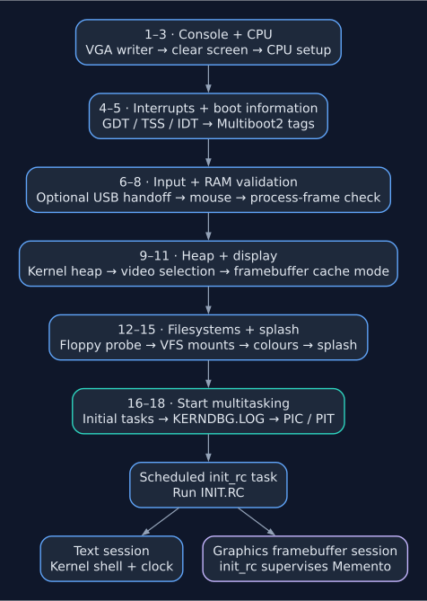

# Boot and Initialization

The `init` module is the kernel's sequential startup orchestrator. It is entered once, runs each subsystem check in order, prints a status line for each step, then hands off to the scheduler — at which point it never runs again.

The single entry point is `init::check::init(m2_ptr: u32)`, called from `main.rs` with the Multiboot2 info pointer left in a register by the bootloader.

---

## Boot Sequence

*Ordered groups of initialization steps. `INIT.RC` runs later in the scheduled
`init_rc` task; it is not one of the 18 sequential checks. The final branches
show the session each boot exposes; the text shell and clock already exist
when the script runs.*

Steps execute in this exact order:

| # | Call | Description |
|---|------|-------------|
| 1 | `vga::init_writer()` | Create the VGA text writer at `0xB8000` |
| 2 | `clear_screen!()` | Blank the text buffer |
| 3 | `cpu::check()` | Enable SSE and set SYSCALL/SYSRET MSRs |
| 4 | `idt::idt_isrs_init()` | Install ISRs, reload GDT, initialize TSS and load IDT |
| 5 | `parser::parse_info(m2_ptr, ...)` | Read framebuffer, usable RAM, command line and ACPI tags |
| 6 | `usb::take_all()` | With `usb=os` only: take controllers from firmware before PS/2 setup |
| 7 | `mouse::init()` | Initialize the PS/2 mouse |
| 8 | `boot::usable_covers(...)` | Check that all 32 process frames, `0x1000000..0x5000000`, lie in usable RAM |
| 9 | `heap::pmm_heap_init()` | Initialize the kernel heap and run its smoke test |
| 10 | `video::print_result(...)` | Select the video path |
| 11 | `video::wc::map_write_combining(...)` | For an RGB framebuffer, map its identity-mapped pages write-combining |
| 12 | `fs::floppy_check_init()` | Probe the floppy and set the working directory to `/` |
| 13 | `fs::vfs_init(fat12)` | Mount the root, writable FAT volumes, CD and boot archive when available |
| 14 | `color::color_demo()` | Print the console colour swatch |
| 15 | `ascii::ascii_art()` | Print the splash |
| 16 | `process::init_processes()` | Save CR3, initialize the shared user heap and create initial tasks |
| 17 | `debug::dump_debug_log_to_memdisk()` | Write `/mnt/tmp/KERNDBG.LOG` |
| 18 | `pit::pic_pit_init()` | Remap the PIC, start the PIT at 1000 Hz and enable interrupts |

Before this sequence, `kernel_main` calls `fs::ustar::module::adopt` to keep the
GRUB-loaded archive clear of fixed process stacks and frames. See
[Boot Medium Archive](../filesystem/overview.md#boot-medium-archive-mnttar).
After step 18, timer interrupts can schedule the initial tasks; `kernel_main`
then enters its idle path, or runs the self-tests with `kernel_test` enabled.

---

## Debug Log

`debug!`, `debugn!` and `debugln!` (`src/debug.rs`) append to `DEBUG_LOG`, an 8 KiB buffer in memory; what does not fit once it is full is dropped. The kernel writes it out at three points:

| When | Where |
|------|-------|
| The Multiboot2 framebuffer tag is parsed (step 5) | `DEBUG.TXT` in the floppy's root, and the serial port (COM1) |
| End of init (step 17) | `/mnt/tmp/KERNDBG.LOG` on the RAM disk |
| The shell's [`debug`](../shell.md#debug-hidden) command | `DEBUG.TXT`, `KERNDBG.LOG` and serial, each file replaced |

`KERNDBG.LOG` is there for a machine with neither a floppy nor a serial line, such as one booted from a USB stick: `read /mnt/tmp/KERNDBG.LOG` shows it. It is written before the timer starts, while no process can be writing to the RAM disk, so it holds everything up to that point and nothing logged afterwards until `debug` is run.

The write at step 5 comes before the floppy probe, and on a machine without a floppy it prints `ERR: Could not find the FAT12 label, floppy may not be present` on the boot screen. It is harmless: the log still reaches serial and, later, the RAM disk.

---

## Global State Set During Init

| Symbol | Type | Set by step | Description |
|--------|------|-------------|-------------|
| `FRAMEBUFFER_PTR` | `boot::FramebufferTag` | 5 | VESA framebuffer address, pitch, dimensions, bpp |
| `VIDEO_MODE` | `Option<VideoMode>` | 10 | Active video path (Framebuffer or TextMode) |
| `SYSTEM_CONFIG` | `Mutex<SystemConfig>` | 12 | hostname, user, cwd, version, IP, MAC |
| `KERNEL_CR3` | `u64` | 16 | Boot-time page table snapshot for process cloning |
| Userland heap P2[6/7] | page table | 16 | `0xC00_000–0xFFF_FFF` mapped USER+WRITE |
| `SCHEDULER` | `Mutex<Scheduler>` | 16 | Initial process slots populated |

---

## Module Table

| File | Purpose |
|------|---------|
| `check.rs` | Entry point `init()`, `FRAMEBUFFER_PTR` global |
| `boot.rs` | Multiboot2 tag structs, `parse_multiboot2_info` |
| `parser.rs` | Thin `Result`-returning wrapper around `boot::parse_multiboot2_info` |
| `cpu.rs` | SSE enable, SYSCALL/SYSRET MSR setup |
| `idt.rs` | GDT reload, TSS init, IDT load |
| `pit.rs` | 8259A PIC remap, PIT init at `TICKS_PER_SECOND` (1000 Hz) |
| `heap.rs` | Kernel heap init + smoke test |
| `fs.rs` | Floppy probe, VFS mount table init |
| `video.rs` | `init_video()`, optional VESA P1 mapping |
| `process.rs` | Initial task creation (kmain, init_rc, kclock, kshell; the last two not on a framebuffer) |
| `config.rs` | `SYSTEM_CONFIG` global, `get_prompt()` |
| `font.rs` | PSF1/PSF2 font parser, `PSF_FONT` static, glyph renderer |
| `ascii.rs` | Splash screen text |
| `color.rs` | 16-color palette swatch |

---

Related documentation: [Kernel Internals](../kernel.md), [Subsystem Setup](subsystems.md), [Build and Run](../build.md).
