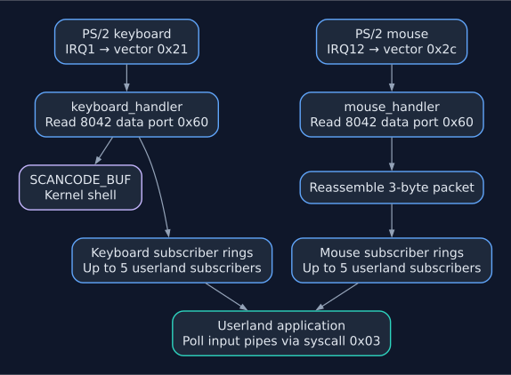

# Input Overview

The input subsystem handles PS/2 keyboards (IRQ1), PS/2 mice (IRQ12), and USB
HID boot keyboards/mice and Apple Wellspring trackpads on PCI xHCI/EHCI
controllers. PS/2 devices use the 8042 controller;
USB input uses native drivers polled from the timer interrupt. Both keyboard
paths deliver Set 1 scancodes to the shell and existing userland subscribers.
Port I/O primitives live in `input/port.rs`.

---

## IRQ Wiring

| IRQ | IDT vector | Handler | Source |
|-----|-----------|---------|--------|
| IRQ1 | `0x21` | `keyboard_handler` | PS/2 keyboard via 8042 port 0x60 |
| IRQ12 | `0x2C` | `mouse_handler` | PS/2 auxiliary port via 8042 port 0x60 |

Both are registered in `abi/idt.rs` by `install_isrs()`.

USB input uses IRQ0's scheduler timer to poll xHCI events and EHCI transfers,
before the scheduler acquires its lock. It does not require a USB controller
interrupt handler.
See [USB keyboard support](keyboard.md#usb-keyboards-xhci).

The 8042 controller shares a single data register (port `0x60`) between keyboard and mouse. The status register (port `0x64`) bit 5 distinguishes the source: `0` = keyboard, `1` = mouse.

---

## Data Flow

*Keyboard scancodes and mouse packets use separate subscriber buffers. Reading
those buffers through syscall `0x03` is non-blocking.*

---

## Modules

| Module | File | Purpose |
|--------|------|---------|
| `keyboard` | `input/keyboard.rs` | Scancode buffer, shell loop, scancode→ASCII, tab completion |
| `irq` | `input/irq.rs` | Keyboard fan-out to up to 5 userland subscribers |
| `xhci` | `usb/xhci.rs` | Controller ownership, DMA rings, USB enumeration and keyboard/mouse/trackpad polling |
| `ehci` | `usb/ehci.rs` | USB2 hub enumeration, split transactions and input polling |
| `hid` | `usb/hid.rs` | Boot keyboard/mouse and Wellspring reports, Set 1 translation and held-key repeat |
| `mouse` | `input/mouse.rs` | PS/2 mouse init, packet reassembly, subscriber ring buffers |
| `port` | `input/port.rs` | Raw x86 I/O port primitives (IN/OUT for u8/u16/u32) |
| `cmd` | `input/cmd.rs` | Shell built-in command dispatcher |
| `elf` | `input/elf.rs` | ELF loader (`run_elf`) called by shell and syscall 0x2A |
| `elf_path` | `input/elf_path.rs` | Validate bare names and explicit absolute executable paths |

---

## PIC Configuration

The 8259A PIC is set up so that hardware IRQs are remapped to IDT vectors `0x20–0x2F` (master `0x20–0x27`, slave `0x28–0x2F`):

- IRQ1 (keyboard) → `0x21` (master)
- IRQ12 (mouse) → `0x2C` (slave, cascade through IRQ2)

The mouse init sequence (`mouse::init`) explicitly unmasks IRQ2 on the master PIC (`0x21 &= ~0x04`) and IRQ12 on the slave PIC (`0xA1 &= ~0x10`). Without these two clears, IRQ12 is permanently masked.

---

## Port I/O Primitives (`input/port.rs`)

All hardware access goes through these wrappers around the `IN`/`OUT` x86 instructions:

| Function | Width | Instruction |
|----------|-------|-------------|
| `read_u8(port)` | 8-bit | `IN AL, DX` |
| `write_u8(port, v)` | 8-bit | `OUT DX, AL` |
| `read_u16(port)` | 16-bit | `IN AX, DX` |
| `write_u16(port, v)` | 16-bit | `OUT DX, AX` |
| `read_u32(port)` | 32-bit | `IN EAX, DX` |
| `write_u32(port, v)` | 32-bit | `OUT DX, EAX` |

`read` and `write` are aliases for the u8 variants and are used throughout the codebase.

Userland accesses port I/O through syscalls `0x30` (write) and `0x31` (read), which call these functions indirectly.

---

Related documentation: [Kernel Internals](../kernel.md), [Keyboard](keyboard.md), [Mouse](mouse.md), [Input Syscalls](../abi/syscalls/sysinfo_mem_mgmt.md#0x03-pipe-handling).
