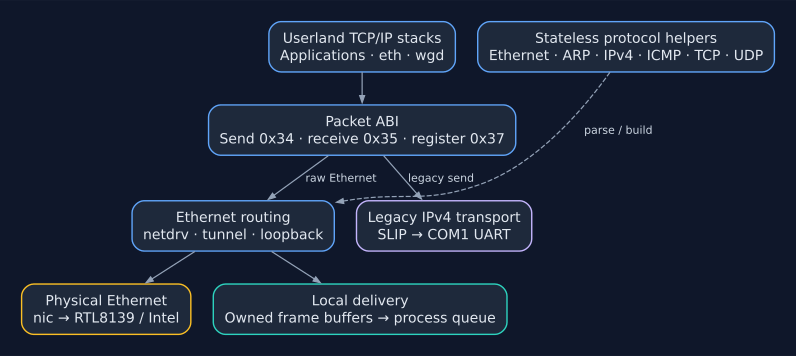
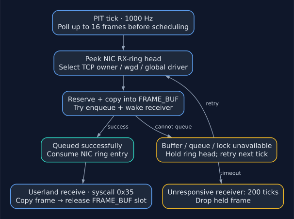
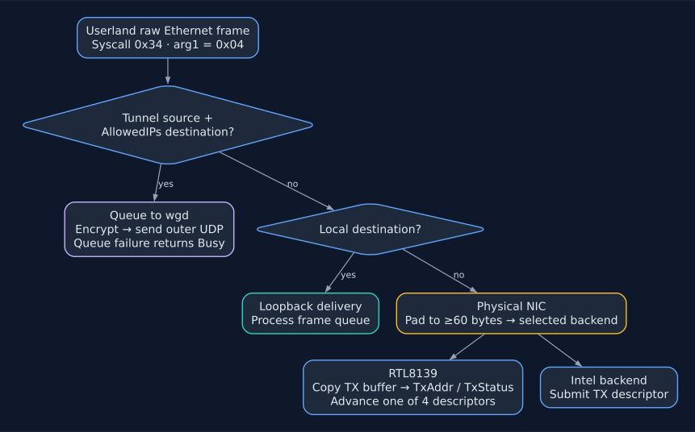

# Networking Overview

## Stack Layers

*Stack responsibilities and transports. The kernel parses and routes packets;
userland stacks own TCP connections and protocol state.*

There are two hardware transport paths. A [userspace WireGuard tunnel](wireguard.md) can run over Ethernet alongside the physical network:

| Path | Hardware | Protocol | Direction |
|------|----------|----------|-----------|
| **Ethernet** | RTL8139, supported Intel PCI NIC, or Broadcom BCM57765 | Ethernet II → IPv4/ARP | TX and RX |
| **Serial/SLIP** | UART COM1 | SLIP-framed IPv4 | TX only (active), RX (loop-based) |

---

## Hardware Diagnostics

ETH registers through syscall `0x37`, which initializes an RTL8139, supported
Intel controller, or wired Broadcom BCM57765 (`14e4:16b4`). If no backend can initialize a card, registration fails and
ETH prints its unsupported-card message and exits. The kernel loopback path
still serves local traffic, so GARN at `http://localhost` can work in this state.

The kernel shell's `nic` command shows PCI network controllers even before a
driver registers. It reports the PCI location, vendor/device ID, subsystem IDs,
BAR0 address, and available R2 backend without writing controller registers.
An ID marked `unsupported` needs a hardware driver; DHCP configuration cannot
add support. A recognized ID can also fail initialization, for example when
its MMIO BAR is outside the NIC driver's mapping.

`/mnt/tmp/NETINFO.TXT` contains the same PCI inventory. It is generated during
boot and refreshed on ETH registration success/failure, so it can be opened
from Memento's file browser or read with `cat` in a shell window. EFI text GRUB
entries use a [framebuffer console](../build.md#intel-mac-usb-boot-including-macbook-pro-2012),
making `nic` visible on Intel Macs.

For BCM57765, the report also records the initialization stage, firmware
mailbox, PHY ID, negotiated link and packet-ring state. See the
[Broadcom backend](hardware.md#broadcom-bcm57765-bcm57765) for hardware
validation status and limits. This product includes software developed by Bill Paul.

## Receive Path (Ethernet)

Frames arrive via polling, not IRQ. On every PIT tick (1000 Hz) the scheduler calls `netdrv::poll_and_deliver()` before selecting the next runnable process:

*Buffer ownership and backpressure. Successful enqueue precedes NIC consumption;
syscall `0x35` releases the owned frame buffer after copying it to userland.*

Each queued frame has a 2 KiB buffer of its own, one of the 64 in `FRAME_BUF`, held for the receiving process until it copies the frame out with syscall `0x35`, which then frees it (so does the process's death, `release_process`). The `Message` carries the buffer's address in `buf_addr` and the frame length in `port_id`. Up to 16 frames are delivered per tick.

A frame that cannot be queued --- no free buffer, the receiver's 64-message queue full, the scheduler locked by the syscall the tick interrupted --- stays at the front of the NIC's ring and is tried again next tick, so nothing is lost between the NIC and the receiver: when anything is dropped, it is by the NIC, once its own ring is full. A frame whose receiver takes nothing for 200 ticks is dropped, so that one process that has stopped reading cannot hold up the traffic for the others. `NETDRV_COUNTERS` counts delivered, held-back and dropped frames and the NIC's missed-packet counter.

Until v0.11 there was one shared 2 KiB buffer, `NET_FRAME_BUF`, and one frame per tick: the next frame overwrote the last whether or not it had been read, so a receiver that was busy for a few milliseconds lost every frame of a burst but the last, and TCP receivers had to keep their windows to a segment or two. Memento's browser took over two minutes for a 700 KiB page on QEMU's user networking; it now receives it in under a tenth of a second.

## Transmit Path (Ethernet)

For Ethernet, userland calls syscall `0x34` with arg1 `0x04` (raw Ethernet). Argument 1 `0x01` uses the legacy serial/SLIP path instead:

*Transmit routing order. Tunnel queue failure returns `Busy`; the selected inner
packet does not fall through to a plaintext NIC send.*

Before routing, the kernel derives the frame length from EtherType and the IPv4
total-length field.

Minimum Ethernet frame size (60 bytes) is enforced by zero-padding in `send_frame`.

## Transmit Path (Serial/SLIP)

Userland calls `ipv4::send_packet`, which:

1. SLIP-encodes the IPv4 datagram (`slip::encode`).
2. Sends each encoded byte through the UART via `serial::write`.

This path is legacy/fallback; the RTL8139 path is preferred for QEMU guests.

## Loopback Device

A frame a process sends to this machine itself never reaches the NIC, which would not hear it anyway: `loopback.rs` takes it in syscall `0x34` and queues it to the process it is for, routed as frames off the NIC are (`netdrv::deliver`: by TCP or UDP destination port, else the global driver). So r2web, Memento or any other stack can reach GARN, TNT or Chat on the same machine, at `127.0.0.1` or at the address DHCP gave it.

| Sent | What happens |
|------|--------------|
| IPv4 to `127.0.0.0/8`, to the machine's address, or with `src == dst` | Queued locally, with the source MAC `00:00:00:00:00:00` (as Linux's `lo`) and the card's MAC as destination. |
| ICMP echo request to one of those | Answered by the kernel, to the sender. |
| ARP request for one of those (sender not `0.0.0.0`) | Answered by the kernel, to the asker, with the MAC `00:00:00:00:00:00`. Still sent out too, unless it is for `127.x`. |

The physical address is the one in `SYSTEM_CONFIG` (set by the ETH driver through syscall `0x01`/`0x3D`); `SystemConfig::set_ip` keeps a lock-free copy for the loopback check. The registered tunnel address is also recognized as local through `tunnel::is_local`.

The zero source MAC matters: the stacks drop frames from their own (the card's) MAC as echoes of their own broadcasts. With it they take a looped reply, learn that their own address is at `00:00:00:00:00:00`, and send there next time, which comes back through the loopback device because of the IP. A looped frame that cannot be queued (no free buffer, the receiver's queue full) is lost, as on a wire; TCP sends it again.

Current `libcr2` TCP sockets preserve the incoming local destination and reply from that address, including the WireGuard tunnel address. Relink older servers to get this behavior. The browser stack (`web/net_r2.cpp`) resolves `localhost` to `127.0.0.1` and connects to the machine's physical address for anything in `127.0.0.0/8`.

---

## Userspace IPv4 Tunnel

`tunnel.rs` registers one daemon through [syscall `0x44`](../abi/syscalls/port_networking.md#0x44-userspace-ipv4-tunnel): a separate local tunnel address, UDP port, MTU and up to 16 IPv4 prefixes. `wgd` holds the WireGuard keys and protocol state. `eth` continues to own the physical address, DHCP and ARP.

Outer UDP for the registered port is queued to `wgd`. It authenticates and decrypts packets, enforces the peer's source prefixes, answers tunnel echo requests, and injects TCP or probe ICMP through the kernel. TCP follows the existing bound-port delivery path; matching ICMP replies go to the shell that reserved the probe.

Outgoing frames whose source is the tunnel address and whose destination matches a configured prefix are queued to `wgd` before loopback/NIC transmission. Queue failure returns `Busy`, without plaintext NIC fallback. The daemon's own outer UDP stays on Ethernet. NIC input with the tunnel address as source or destination is dropped. Ordinary application connections keep using the physical address unless their stack explicitly selects the tunnel source.

The userland `sh`/TNT builtins `ping` and `traceroute` select that source to reach hosts in `AllowedIPs`. See [WireGuard](wireguard.md) for configuration, hosted-shell diagnostics, entropy fallback, subnet routing and current limits.

---

## Driver and Port Registry

`netdrv.rs` maintains the following tables. Registration and process cleanup
update them with interrupts disabled; polling reads them without a mutex.

| Table | Size | Contents |
|-------|------|----------|
| `NET_DRV_PID` | 1 entry | Scheduler slot of the global Ethernet driver (ARP, ICMP, unbound TCP/UDP) |
| `PORT_REGISTRY` | 16 entries | `(tcp_dest_port, slot)` for services and client reply ports |
| `UDP_PORT_REGISTRY` | 16 entries | `(udp_dest_port, slot)`, independent of TCP bindings |

### Registration (syscall `0x37`)

- `arg1 = 0`: register as global driver. Probes RTL8139 first, then supported Intel controllers and Broadcom BCM57765 through `nic::init`, and reads and caches the MAC address in `SYSTEM_CONFIG`. Idempotent — no-op if a driver is already registered.
- `arg1 = N > 0`, `arg2 = 0`: bind TCP destination port `N` to the caller. Binding a port it already owns succeeds; a port owned by another process or a full table returns `Busy` without changing existing entries.
- `arg1 = N > 0`, `arg2 = 1`: release the caller's TCP binding. Releasing an unbound port succeeds; releasing another process's port returns `Busy`.
- `arg1 = N > 0`, `arg2 = 2`/`3`: bind/release UDP destination port `N`, with the same ownership and capacity rules in its own table. Ports must fit in 16 bits; other operations return `InvalidInput`.

Registrations last as long as the process. When it exits, is killed or crashes, `scheduler::kill`/`crash` call `netdrv::release_process(slot)`: the global driver slot is freed if the process held it, its port bindings are dropped, and so are the buffers of frames still queued to it. The next process to register becomes the driver; the NIC stays initialised. Until then, frames for bound ports are still delivered, and frames nobody is registered for are dropped.

### Frame Routing

On each incoming frame `poll_and_deliver` first rejects physical input using
the local tunnel address. Delivery checks the registered tunnel's UDP port
first, then UDP and TCP destination bindings. A tunnel match goes to its
daemon, a bound port to its owner's queue, and everything else (ARP, ICMP,
unregistered ports) to `NET_DRV_PID`. Ordinary UDP bindings accept complete,
unfragmented IPv4 packets with consistent IP and UDP lengths. The receiving
userland stack verifies UDP checksums and interprets the payload.

ARP replies are the exception to one destination: besides the driver, every
other process with a TCP or UDP port bound gets a copy (once per process,
best effort: a copy that finds no free frame buffer is not made). Those
processes run stacks of their own, including Memento's NTP client, browser,
video player and chat, and ARP for hosts on the local network themselves.
Without the copy they could reach the gateway, whose MAC the driver publishes
(syscall `0x3d`), but never a machine beside them on the LAN.

---

## Network Monitoring

Two read-only syscalls expose system-wide network state:

| Syscall | Snapshot | Reference |
|---------|----------|-----------|
| `0x45` | Physical NIC RX/TX frame and byte totals since boot, with a millisecond timestamp | [NetStats](../abi/type_definitions.md#netstats-syscall-0x45), [counter semantics](../abi/syscalls/port_networking.md#0x45-network-throughput-statistics) |
| `0x46` | TCP destination ports, full 64-bit owner PIDs, bounded process names and the global driver's PID | [NetPortTable](../abi/type_definitions.md#netporttable-syscall-0x46), [return codes](../abi/syscalls/port_networking.md#0x46-tcp-port-owners) |

RX counts a frame when software consumes it from the NIC ring; retrying a held
frame or copying an ARP reply to several queues does not count it again. TX
counts successful submissions, including Ethernet padding. Bytes exclude the
FCS, preamble and inter-frame gap. Loopback, SLIP and tunnel inner traffic are
excluded; encrypted tunnel traffic on the physical NIC counts normally.
Counters survive driver restarts and NIC reinitialization.

The owner table resolves the registry's reusable slots to process identities
under the scheduler lock. A busy scheduler returns `Busy`; retry the snapshot.
The [C](../sdk/libcr2.md#network-monitoring),
[C++](../sdk/libcxxr2.md#network-monitoring) and
[Go](../sdk/libgor2.md#network-monitoring) bindings provide wrappers.
[Memento's Net window](../sdk/memento.md#network-tools) displays these snapshots
and falls back to its own traffic counters and port numbers on older kernels.

---

## Limits

| Resource | Value |
|----------|-------|
| RTL8139 RX ring buffer | 32 KiB (RCR RBLEN = 10) + 1500-byte overrun guard |
| RTL8139 TX descriptors | 4 (round-robin) |
| Intel RX / TX descriptors | 32 / 64 (2 KiB buffers) |
| BCM57765 RX producer / return / TX descriptors | 512 / 512 / 512 (64 RX and 32 TX buffers of 2 KiB) |
| TX buffer per descriptor | 2 KiB |
| Queued-frame buffers (`FRAME_BUF`) | 64 x 2 KiB |
| Messages queued per process | 64 |
| Max port bindings | 16 |
| SLIP encode/decode buffer | 4 KiB |
| Serial baud rate | 38 400 (COM1, divisor 3) |
| Poll rate | 1000 Hz, up to 16 frames per PIT tick |

---

Related documentation: [Kernel Internals](../kernel.md), [Hardware Layer](hardware.md), [Protocol Layer](protocols.md), [WireGuard](wireguard.md).
